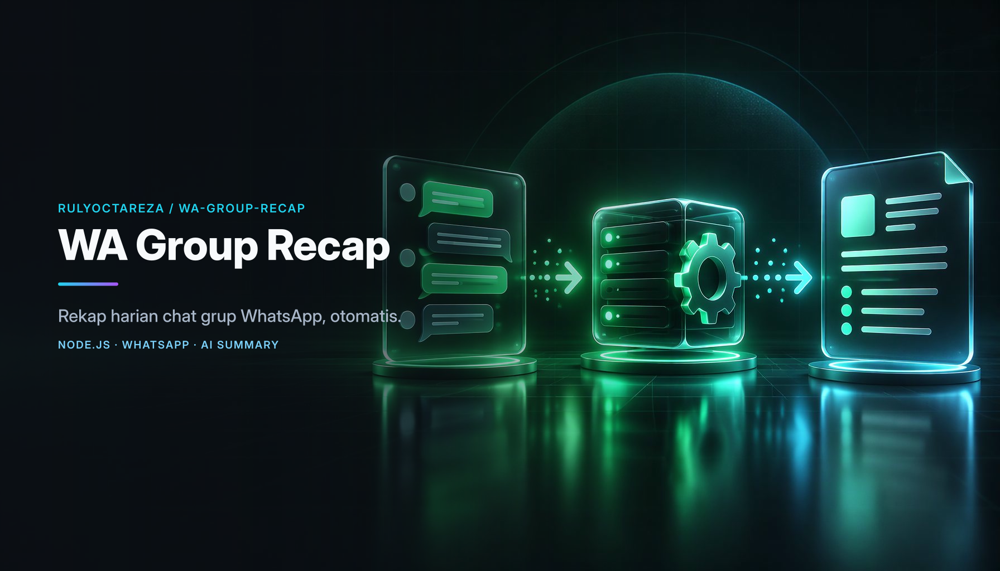

<p align="center">
  
</p>

<h1 align="center">wa-group-recap</h1>

<p align="center">
  <b>Rekap harian chat grup WhatsApp, otomatis.</b><br>
  Pesan grup → txt → web summary → dikirim balik ke WhatsApp
</p>

<p align="center">
  
  
  
  
</p>

---

## ✨ Preview

<p align="center">
  
</p>

> **Catatan:** gambar di atas adalah *ilustrasi konsep*, bukan screenshot asli.

---

## 📖 Tentang

Rekap harian chat grup WhatsApp yang otomatis: pesan grup terpilih ditangkap di server,
dirangkum per hari jadi file txt, dikirim ke web summary, lalu hasil summary-nya dikirim
ke nomor WhatsApp tujuan.

> **Cuma butuh skrip?** [`standalone/wa-recap.js`](standalone/) = seluruh alur dalam satu file
> Node.js (WhatsApp Web, tanpa Docker/DB/Python).

```text
 Grup WhatsApp                        Server (Docker)                              Web summary
┌──────────────┐  perangkat   ┌────────────────────────────────────┐   POST txt   ┌──────────────┐
│ Grup A, B, C │──tertaut────▶│ Evolution API ──▶ Postgres          │────────────▶│ RECAP_API_URL│
└──────────────┘  (Baileys)   │    │  (simpan semua pesan masuk)    │◀────────────│  (Vercel)    │
                              │    ▼                                 │   summary    └──────────────┘
                              │ cleanup.py   tiap menit              │
                              │ export.py   05:00 → txt → summary ───┼──▶ WA penerima (RECIPIENTS)
                              └────────────────────────────────────┘
```

---

## 🔀 Dua mode tangkap

| | **Evolution** (default) | **WhatsApp Web** (`webjs/`, eksperimental) |
|---|---|---|
| Cara nyambung | Evolution API (Baileys) | `whatsapp-web.js` di Chrome headless |
| Online | 24 jam | Hanya saat rekap (±5 menit/hari) |
| Penyimpanan | Postgres + Redis | Tanpa DB |
| Server | ±190 MB RAM terus-menerus | Node ≥ 18 + Chrome, ±500 MB saat rekap |
| Kelemahan | Jejak lebih besar | Rawan rusak saat WhatsApp Web update |

Keduanya tidak resmi dan sama-sama melanggar ToS WhatsApp. Mode WhatsApp Web hanya
memperkecil jejak. Tahap txt → summary → kirim WA memakai kode yang sama (`recap/export.py`).

---

## ⚙️ Cara kerja

| Tahap | Komponen | Detail |
|---|---|---|
| 1. Tangkap | Evolution API | Login sebagai perangkat tertaut, simpan pesan ke Postgres |
| 2. Saring | `recap/cleanup.py` | Buang pesan grup non-target tiap menit; hapus pesan lama sesuai `DB_RETENTION_DAYS` |
| 3. Export | `recap/export.py` | Ambil pesan kemarin → `output/<grup>/<grup>_<tanggal>.txt` |
| 4. Summary | `recap/summarize.py` | POST tiap txt ke `RECAP_API_URL`, ambil teks summary dari respons |
| 5. Kirim | Evolution API | Kirim summary ke nomor di `RECIPIENTS` |

Format baris txt: `[08:15] Nama: isi pesan`, balasan ditandai `↪ balas: "..."`,
media jadi `[gambar] caption`, reaksi & pesan sistem dibuang.

---

## 🚀 Setup singkat

```bash
cp groups.example.txt groups.txt   # daftar grup yang mau direkap
cp .env.example .env               # isi kredensial & RECIPIENTS
./setup.sh
docker compose up -d
```

Kontrak request/response ke web summary diatur lewat `.env` — lihat
[docs/WEB_API.md](docs/WEB_API.md).

---

## 📁 Struktur

```text
├── recap/            # cleanup.py, export.py, summarize.py
├── webjs/            # Mode WhatsApp Web (eksperimental)
├── standalone/       # wa-recap.js — satu file, tanpa Docker
├── docs/             # WEB_API.md
├── docker-compose.yml
└── setup.sh
```
